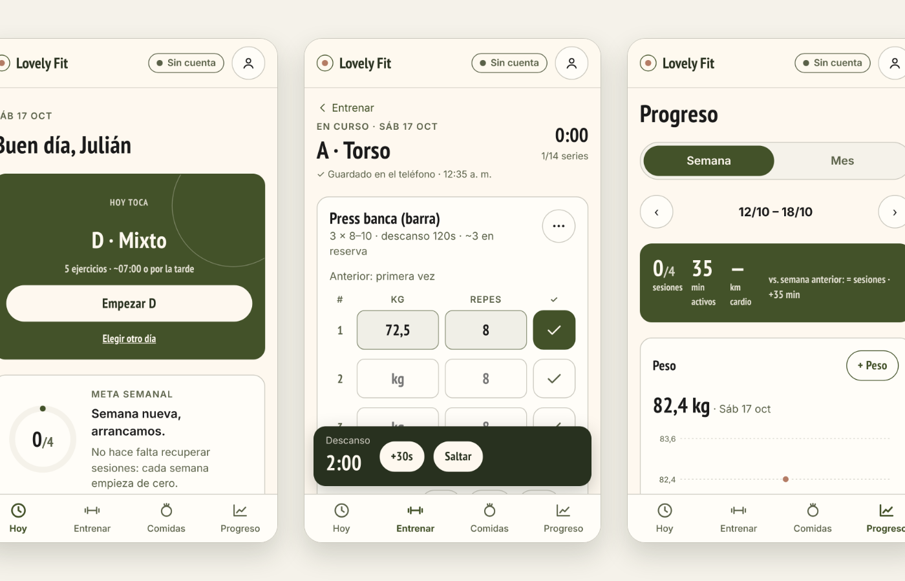

# Lovely Fit

App móvil para registrar entrenamiento de fuerza, comidas y progreso personal. La armé para uso propio:
quería algo rápido para usar en el gimnasio, que funcione sin señal y que no me obligue a pesar cada
comida para tener un registro útil.



## Qué hace

- **Sesión de fuerza.** Cada serie muestra lo que hiciste la vez anterior y se completa con un toque. Al marcarla
  arranca el descanso. Se pueden sustituir, omitir o reordenar ejercicios en medio de la sesión, y si la app se
  cierra, la sesión sigue donde quedó.
- **Plan semanal editable.** Días, ejercicios, series, rangos de repeticiones y descansos. Cuando completás el
  rango dos sesiones seguidas, sugiere subir el incremento mínimo de ese ejercicio.
- **Comidas sin balanza.** Comidas habituales guardadas, porción chica/normal/grande y foto opcional. Las
  calorías son una estimación editable, y "sin estimación" no se cuenta como cero.
- **Progreso.** Vista semanal y mensual de sesiones, minutos activos, cargas, peso, cintura y pasos. Solo usa
  datos reales: si un día no tiene dato, se muestra como vacío y no como cero.
- **Cardio y recorridos.** Carga manual o importación de GPX. El mapa se dibuja únicamente con coordenadas
  reales y sin enviar la ubicación a servicios de mapas.

## Cómo está hecha

Es una PWA **local-first**: todo se escribe primero en IndexedDB, así que registrar algo nunca depende de la
conexión. La nube es opcional y sirve para respaldo y para usar más de un dispositivo.

| | |
|---|---|
| Frontend | Next.js 16 (App Router, exportación estática), React 19, TypeScript, CSS propio |
| Datos en el dispositivo | IndexedDB con Dexie; service worker con precache generado en el build |
| Backend | Supabase: Postgres con Row Level Security, Auth por código de email, Storage privado |
| Hosting | Vercel (sitio estático, sin servidor propio) |
| Pruebas | Vitest (lógica y esquema), Playwright (flujos en viewport móvil, modo offline), SQL contra Postgres |

Algunas decisiones que vale la pena mencionar:

- **Sincronización.** Cada registro tiene un UUID generado en el cliente y una marca de cambios pendientes.
  La subida es un `upsert` por id, así que reintentar nunca duplica. Los conflictos se resuelven con
  last-write-wins por registro, aplicado tanto en el cliente como en un trigger de Postgres. La bajada es
  incremental, con un cursor sobre `server_updated_at`.
- **Seguridad.** Cada tabla filtra por `owner_id = auth.uid()` y las fotos van en carpetas por usuario dentro
  de un bucket privado. En el navegador solo existe la clave pública. Las políticas tienen pruebas propias:
  otro usuario no puede leer, escribir ni hacerse pasar por el dueño.
- **Fechas.** Los días se calculan en la zona horaria del usuario y no en UTC: un entrenamiento a las 23:30
  cuenta para ese día.
- **Login por código y no por enlace.** En iOS, un enlace mágico abre Safari, que no comparte almacenamiento con
  la app instalada en la pantalla de inicio.

## Correrla localmente

```bash
npm install
npm run dev            # http://localhost:3000
```

Sin variables de entorno funciona en modo local. Para sincronizar, copiá `.env.example` a `.env.local` con la
URL y la clave publishable de un proyecto Supabase, y aplicá `supabase/migrations/0001_lovely_fit.sql`.

```bash
npm test               # unitarias
npm run build          # genera out/ y el service worker
npm run test:e2e       # flujos completos en Chromium
```

## Documentación

- [Producto: alcance, estado y decisiones](docs/PRODUCTO.md)
- [Instalación y despliegue](docs/INSTALACION.md)
- [Integraciones (Salud, Atajos, reloj, GPX)](docs/INTEGRACIONES.md)
- [Sistema visual](docs/DISENO.md)
- [Calidad y checklist en iPhone](docs/QA.md)

## Estado

En uso personal y en desarrollo activo. Los recordatorios push y la importación automática desde Salud
todavía no están terminados; en [docs/PRODUCTO.md](docs/PRODUCTO.md) está el detalle de qué funciona y qué no.

Las rutinas que trae son un punto de partida editable, no una indicación profesional.

---

Julián Quintero · diseño y desarrollo
